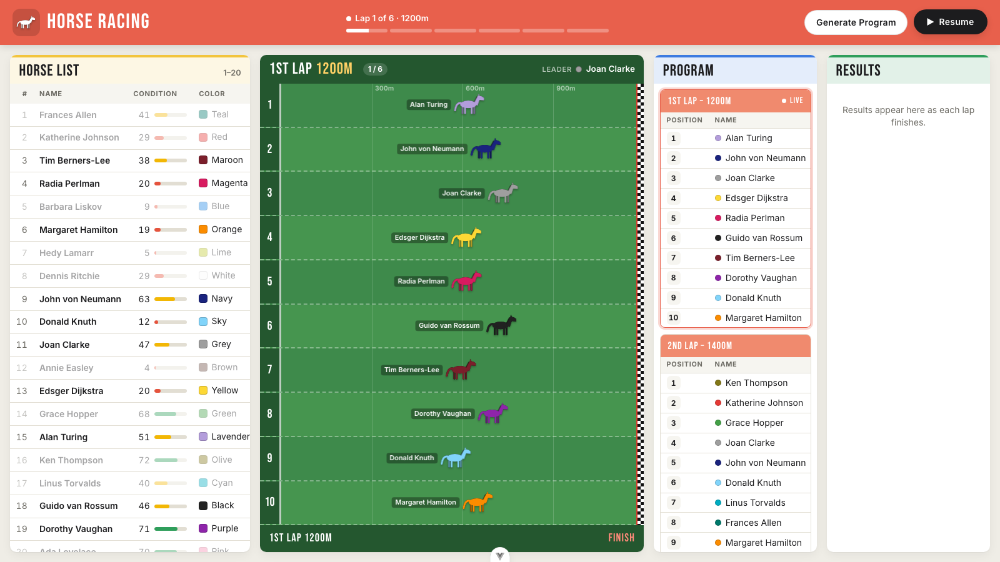
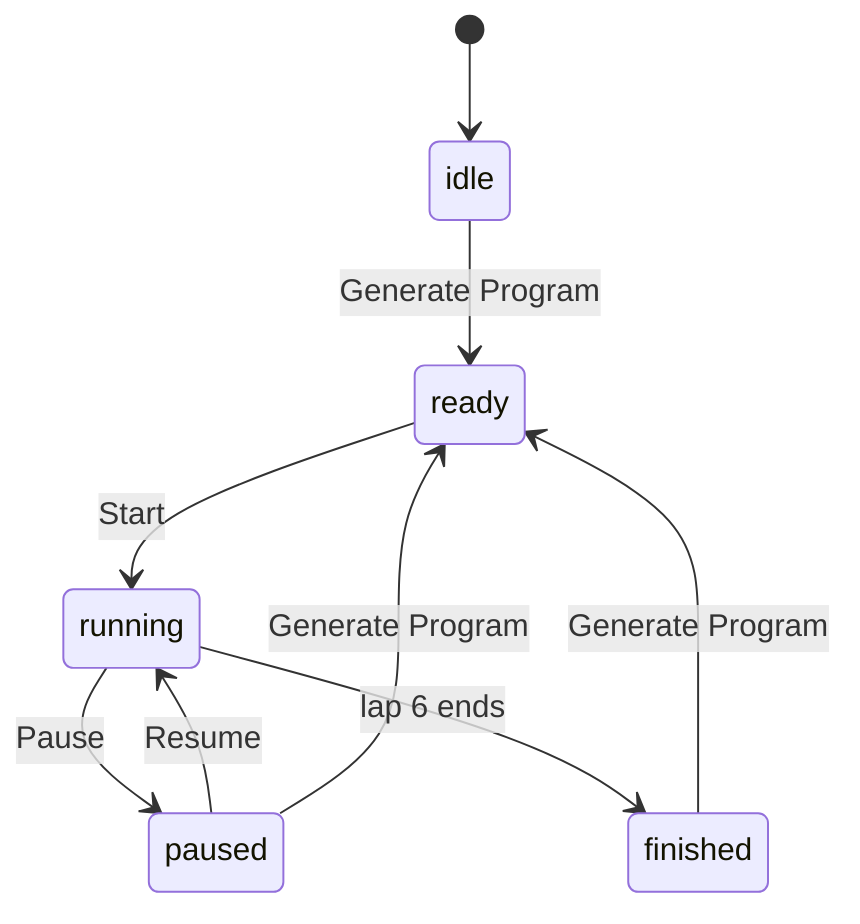

# Horse Racing

An interactive horse racing game built with Vue 3, TypeScript and Pinia.

20 horses, a 6-lap program, animated races and results that arrive lap by lap.

[](#lighthouse-scores)
[](#lighthouse-scores)
[](#lighthouse-scores)
[](#lighthouse-scores)

**Live demo:** https://&lt;github-user&gt;.github.io/insider-case/



## Features

- **Horse list:** 20 horses, each with a unique color and a condition score between 1 and 100.
- **Program:** _Generate Program_ draws 6 laps (1200m → 2200m), each with 10 random horses from the stable.
- **Race:** _Start_ runs the laps one after another. _Pause_ / _Resume_ freezes and continues the race at any moment.
- **Results:** each lap's finishing order and race time are posted the moment its last horse crosses the line.
- **Animations:** galloping horses with leg and tail motion, a 3‑2‑1 countdown, live leader, finish-place badges, a winner banner, lap progress in the header, and confetti when the program ends. All decorative motion respects `prefers-reduced-motion`.
- **Responsive:** three columns on wide screens, stacked panels on tablets and phones.
- **PWA:** installable Progressive Web App with web app manifest, maskable & touch icons, and native install prompt.
- **Printable results:** one-click print button and paper-optimized `@media print` stylesheet for clean physical printing or PDF export.

## Getting started

Requires Node 24 (see `.nvmrc`).

```sh
npm install
npm run dev          # http://localhost:5173
```

### Scripts

| Script                       | What it does                                        |
| ---------------------------- | --------------------------------------------------- |
| `npm run dev`                | Vite dev server with hot reload                     |
| `npm run build`              | Type-check and build for production into `dist/`    |
| `npm run preview`            | Serve the production build on http://localhost:4173 |
| `npm run test`               | Unit and component tests (Vitest), single run       |
| `npm run test:unit`          | Same, in watch mode                                 |
| `npm run test:coverage`      | Unit test coverage report with v8                   |
| `npm run test:e2e`           | End-to-end tests in Chromium, Firefox and WebKit    |
| `npm run test:visual`        | Screenshot comparison tests                         |
| `npm run test:visual:update` | Re-create the screenshot baselines                  |
| `npm run lint`               | oxlint + ESLint, with auto-fix                      |
| `npm run format`             | Prettier                                            |

Before the first E2E run, install the browsers once:

```sh
npx playwright install
```

## How the race works

Each horse has a base speed between 15 and 18 m/s, set by its condition. Every lap, it also gets a
random **form** of ±8%, so a strong horse usually wins but upsets happen. Race time is
`distance / (base speed × form)`.

Races are played back 12× faster than real time, so a 1200m lap takes about 6 seconds on screen.
During a lap each horse's pace rises and falls along its own sine curve. Horses overtake each
other mid-race, but each one still crosses the line exactly at its race time, which keeps the
animation and the results in agreement.

Every lap is planned in full when the program is generated. Starting, pausing and resuming only
move a clock forward, so pausing is exact and the race logic can be tested without a browser.

## Architecture

```
src/
├── constants/game.ts        Rules and tuning: counts, distances, speeds, timings
├── data/horses.ts           Name and color pools
├── types/                   Horse, Lap, Runner, LapResult, RaceStatus, PersistedRaceState
├── utils/                   Pure functions, no Vue
│   ├── random.ts            Seeded PRNG, shuffle, sample
│   ├── horses.ts            Stable generation
│   ├── schedule.ts          6-lap program generation
│   ├── race.ts              Speed, progress curve, lap length, ranking
│   ├── format.ts            Race time and ordinal formatting
│   ├── storage.ts           Safe localStorage persistence wrapper
│   └── audio.ts             Web Audio API synthesis: countdown, bell, gallop, fanfare
├── stores/                  Pinia, setup-style
│   ├── horses.ts            The stable (persisted in localStorage)
│   └── race.ts              Program, status, race clock, results (persisted)
├── composables/
│   ├── useRaceLoop.ts       requestAnimationFrame → race.tick(delta)
│   ├── useScrollIntoView.ts Follows the live lap / newest result
│   ├── useTheme.ts          Reactive dark/light theme composable with system detection
│   ├── useRaceAudio.ts      Coordinates race state with synthesized sound effects
│   └── usePwaInstall.ts     PWA install prompt state and action handler
└── components/
    ├── AppHeader.vue        Title, status, lap meter, Generate / Start-Pause
    ├── HorseList.vue        Horse table
    ├── RaceTrack.vue        10 lanes, countdown, badges, winner banner
    ├── ProgramPanel.vue     Upcoming laps
    ├── ResultsPanel.vue     Finished laps
    ├── LapTable.vue         Shared lap table (used by Program and Results)
    ├── BasePanel.vue        Panel shell with title and slots
    └── HorseIcon.vue        Animated SVG horse
```

The layers only depend downwards: **components → stores → utils → types/constants**.

- **Utils** hold the game rules as pure functions. They take a `random` function as a parameter, so tests can pass a seeded one.
- **Stores** own the state and the transitions between states. They contain no DOM or timer code.
- **Components** render store state and forward user actions. The only "engine" in the view
  layer is `useRaceLoop`, which turns animation frames into `tick(delta)` calls.

### Race state



While `running`, `tick(delta)` advances `elapsedMs`. Each lap goes through a countdown
(`elapsedMs < 0`), the race itself, and a short gap. The result is recorded when the last horse
finishes, and the next lap starts after the gap.

## Testing

| Layer      | Tool                    | Covers                                                                   |
| ---------- | ----------------------- | ------------------------------------------------------------------------ |
| Unit       | Vitest                  | Generators, schedule rules, speed/progress math, ranking, formatting     |
| Store      | Vitest + Pinia          | Status transitions, countdown, lap flow, pause, full program, regenerate |
| Component  | Vitest + Vue Test Utils | Lap table rendering, header buttons through Start → Pause → Resume       |
| End-to-end | Playwright              | The full user flow in Chromium, Firefox and WebKit                       |
| Visual     | Playwright screenshots  | Initial, program generated, mid-race (paused) and finished screens       |

The E2E and visual tests are deterministic without any test-only code in the app:

- `Math.random` is replaced with a seeded generator before the page loads (`e2e/fixtures.ts`).
- Playwright's [clock API](https://playwright.dev/docs/clock) fakes time, so a whole 6-lap
  program can be fast-forwarded in seconds and paused at an exact frame.

Visual baselines depend on the operating system's font rendering, so they are stored per platform
(`e2e/visual/snapshots/*-<platform>.png`). CI runs the functional E2E suite. Run the visual
suite locally, and use `npm run test:visual:update` after an intended UI change.

## Browser support

The application is built on modern web standards:

- **CSS Container Queries** (`container-type: inline-size` & `cqw` units in `RaceTrack.vue`) for dynamic lane-width horse positioning
- **CSS Custom Properties** (`--p`, `--coat`, `--i`) for zero-allocation animation state
- **CSS Grid & Flexbox** for responsive 3-column and stacked panel layouts
- **SVG Animations** with CSS keyframe timing functions
- **Modern ECMAScript (ES2022+)** and Web APIs (`requestAnimationFrame`, `matchMedia('prefers-reduced-motion')`)

### Supported browsers

| Browser                                           | Minimum Version | Tested in CI                  | Notes                                             |
| ------------------------------------------------- | --------------- | ----------------------------- | ------------------------------------------------- |
| **Google Chrome / Chromium** (Edge, Brave, Opera) | Chrome 105+     | Yes (Chromium)                | Full CSS Container Query (`cqw`) support          |
| **Mozilla Firefox**                               | Firefox 110+    | Yes (Firefox)                 | Full CSS Container Query and SVG keyframe support |
| **Apple Safari / WebKit** (macOS, iOS)            | Safari 16.0+    | Yes (WebKit)                  | Native CSS Container Query support                |
| **Mobile Browsers** (Chrome Android, iOS Safari)  | Modern versions | Yes (Mobile/Tablet viewports) | Responsive layout down to 360px viewport width    |

All 3 core rendering engines (Chromium, Firefox, and WebKit) are tested automatically on every pull request and push to `main` via Playwright in the CI pipeline.

## Lighthouse scores

Audited with Google Lighthouse on both **Mobile** (Moto G Power emulation, simulated 4G throttling) and **Desktop** presets against the production build:

| Category             | Mobile  | Desktop |    Status    |
| :------------------- | :-----: | :-----: | :----------: |
| **Performance**      | **100** | **100** | Pass (Green) |
| **Accessibility**    | **100** | **100** | Pass (Green) |
| **Best Practices**   | **100** | **100** | Pass (Green) |
| **SEO**              | **100** | **100** | Pass (Green) |
| **Agentic Browsing** | **100** | **100** | Pass (Green) |

Key optimizations contributing to the scores:

- **Zero layout shift (CLS = 0.00)** through explicit container dimensions and fixed-ratio track lanes.
- **Sub-second paint (FCP / LCP < 0.8s)** via self-hosted variable font subsets and lean asset bundles.
- **Accessible contrast (WCAG AAA)** across light and dark themes, semantic table column scopes (`scope="col"`), and heading structure (`h1` → `h2`).
- **Standardized discoverability**: Standalone web app manifest, touch and maskable icons, search directives (`robots.txt`), AI context descriptor (`llms.txt`), and Agentic Resource Discovery manifest (`.well-known/ard.json`).

## Lighthouse scores

Audited with Google Lighthouse on both **Mobile** (Moto G Power emulation, simulated 4G throttling) and **Desktop** presets against the production build:

| Category | Mobile | Desktop | Status |
| :--- | :---: | :---: | :---: |
| **Performance** | **100** | **100** | Pass (Green) |
| **Accessibility** | **100** | **100** | Pass (Green) |
| **Best Practices** | **100** | **100** | Pass (Green) |
| **SEO** | **100** | **100** | Pass (Green) |
| **Agentic Browsing** | **100** | **100** | Pass (Green) |

Key optimizations contributing to the scores:
- **Zero layout shift (CLS = 0.00)** through explicit container dimensions and fixed-ratio track lanes.
- **Sub-second paint (FCP / LCP < 0.8s)** via self-hosted variable font subsets and lean asset bundles.
- **Accessible contrast (WCAG AAA)** across light and dark themes, semantic table column scopes (`scope="col"`), and heading structure (`h1` → `h2`).
- **Standardized discoverability**: Standalone web app manifest, touch and maskable icons, search directives (`robots.txt`), AI context descriptor (`llms.txt`), and Agentic Resource Discovery manifest (`.well-known/ard.json`).

## Build & deploy

The app is a static site. `npm run build` writes everything to `dist/`.

### GitHub Pages (included)

`.github/workflows/deploy.yml` builds and publishes on every push to `main`.

1. Push the repository to GitHub.
2. Go to **Settings → Pages → Build and deployment** and set **Source** to **GitHub Actions**.
3. Push to `main`, or run the _Deploy to GitHub Pages_ workflow manually from the **Actions** tab.
4. The site appears at `https://<github-user>.github.io/<repo>/`.

The workflow sets `BASE_PATH=/<repo>/` so asset URLs work under the repository sub-path.

### Netlify / Vercel

Import the repository and use:

| Setting          | Value           |
| ---------------- | --------------- |
| Build command    | `npm run build` |
| Output directory | `dist`          |
| Node version     | 24              |

No `BASE_PATH` is needed, since these hosts serve from the root.

### Any static host

```sh
npm ci
npm run build
# upload dist/ (for a sub-path, build with BASE_PATH=/sub-path/ npm run build)
```

### Continuous integration

`.github/workflows/ci.yml` runs on every push and pull request:

1. Prettier check, oxlint + ESLint, unit tests, type-check and production build.
2. E2E tests against the production build (`vite preview`) in Chromium, Firefox and WebKit,
   in parallel. A Playwright report is uploaded if anything fails.

## Assumptions & decisions

- **"Horse list (1–20)"** is read as 20 horses numbered 1 to 20. The rules section asks for a total of 20, and every lap needs 10.
- **Generate Program** draws a new program from the existing stable instead of re-rolling the horses. It is disabled while a race is running, and allowed while paused or after the last lap. Generating resets the results.
- **Program positions** are gate (lane) numbers. **Result positions** are finishing places.
- **Horse names** are computing pioneers, following the example in the brief.
- **Session persistence**: The stable of 20 horses, generated 6-lap program, completed results, and race clock are persisted in `localStorage`. Reloading or closing the tab preserves the session; mid-race reloads resume cleanly in a paused state.
- **Dark theme**: First-class dark mode support with automatic system preference detection (`prefers-color-scheme`), explicit manual toggle, and persistence.
- **Audio synthesis**: Procedural racecourse sound effects built on the Web Audio API (zero audio file dependencies) featuring countdown alerts, race start bell, turf galloping soundscape, and photo-finish fanfare, complete with mute controls.
